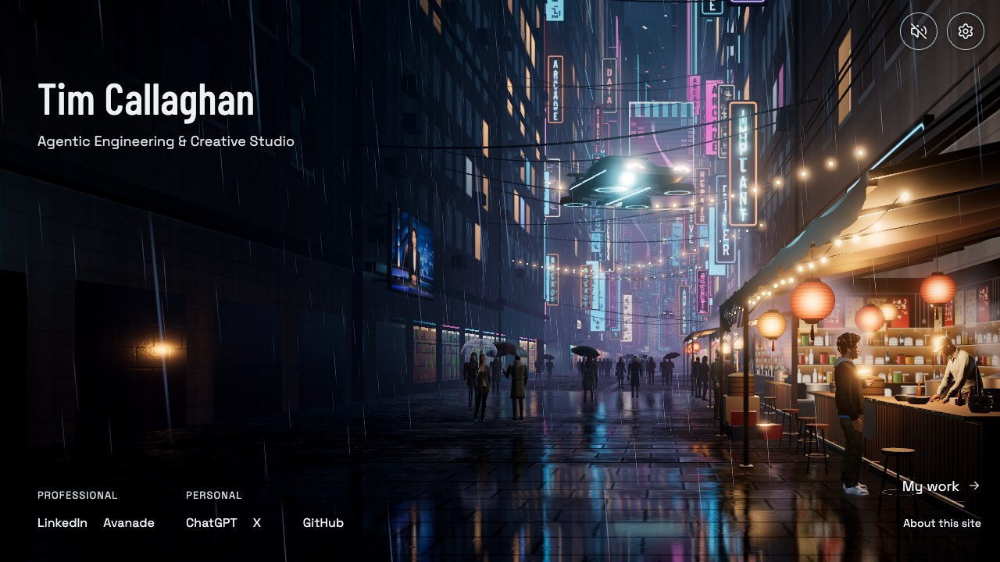

# Night Passage

Night Passage is the rainy neon street behind Tim Callaghan’s personal site. Look past the links and you’ll find flying traffic, pedestrians under umbrellas, a lit food stall and a billboard that gives way to project adverts. The street keeps moving and the soundtrack keeps playing as you read.



*The snapshot running in a 1280 × 720 browser at the High scene preset.*

[Visit the live site](https://aboutme.tclabs.uk/).

## Run it locally

From the repository root, with Python 3.9 or later:

```sh
python3 -m http.server --bind 127.0.0.1 --directory site 8000
```

Open [http://127.0.0.1:8000/](http://127.0.0.1:8000/). The site is ready to serve with no build step. It uses WebGL 2 for the moving scene and a still when WebGL is unavailable.

Use the speaker button to hear **“Neon Rain Blues (Deckard)”**, made by Tim Callaghan with Suno, mixed with six street foley and sound effects layers generated with ElevenLabs. The gear opens volume, motion and scene quality controls.

## Follow the scene and sound through navigation

With sound on, follow **Home → About this site → My work → Home**. [Navigation](site/src/page-navigation.js) fetches each standalone page on demand, parses it as an inert template and swaps in its `main` element. The browser keeps the same document, renderer, canvas, controls and Web Audio context. Back and Forward restore the chapter or saved reading position in About.

[Audio transport](site/src/audio-transport.js) verifies each piece and reassembles the seven shipped tracks for decoding. [The audio engine](site/src/audio-engine.js) can start rain while other tracks load. Music starts at its opening, city and crowd join the shared clock, and steps, kitchen activity and a flyby trigger their own cues. Opening a panel keeps the original loop sources and their start times in place.

[Open the navigation checks](http://127.0.0.1:8000/checks/navigation.html) while the server is running. With browser motion enabled, choose **Run scene and sound check**. It verifies all seven audio tracks, compares the four loop start times, and checks that frames and the audio clock keep advancing through navigation and history. Choose **Reset checks**, then **Run chapter history check** to exercise chapter anchors and saved reading positions.

Run the audio engine and transport tests with Node.js 22.7 or later:

```sh
node --test tests/*.test.mjs
```

## Where to look

- [Scene entry point](site/src/main.js) assembles the street and drives the render loop.
- [City](site/src/city.js), [wet street](site/src/ground.js) and [weather](site/src/fx.js) cover procedural geometry, reflections and atmosphere.
- [Foreground characters](site/src/hero-figures.js) load and animate the Rocketbox models.
- [Billboard](site/src/hoarding.js) warps a still of a fictional presenter and dissolves into procedural adverts, all on scene time.
- [Audio manifest](site/src/audio-manifest.js) records the ordered audio pieces, lengths and hashes.
- [Browser regression](site/checks/navigation-browser-tests.js) records clocks, loop starts and history checkpoints.

## Snapshot provenance and credits

The site comes from the shipped public distribution of release source `04888bf1d4b955466d292ad5a273d758bd32e3d2`. This snapshot preserves the shipped scene, media, fonts, runtime libraries and notices byte for byte. It adds reader documentation and local checks, removes the private dashboard entry from My work, and leaves out the production hosting headers and crawler files.

The bundled software, fonts and models carry their own licence notices. See [site credits and licences](site/LICENSES.md) and the [individual Rocketbox model credits](site/assets/figures/CREDITS.md).
